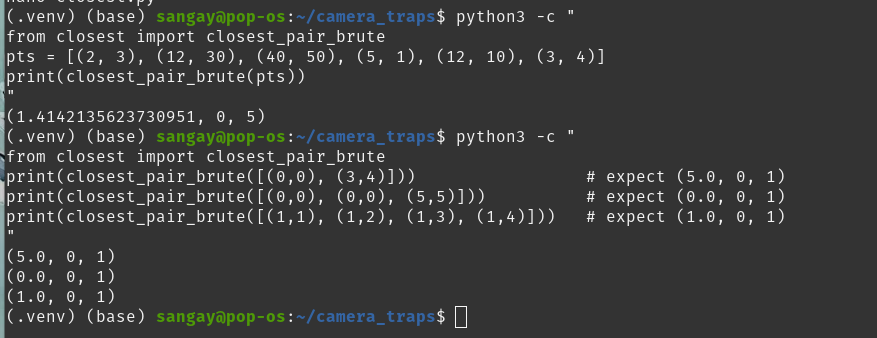
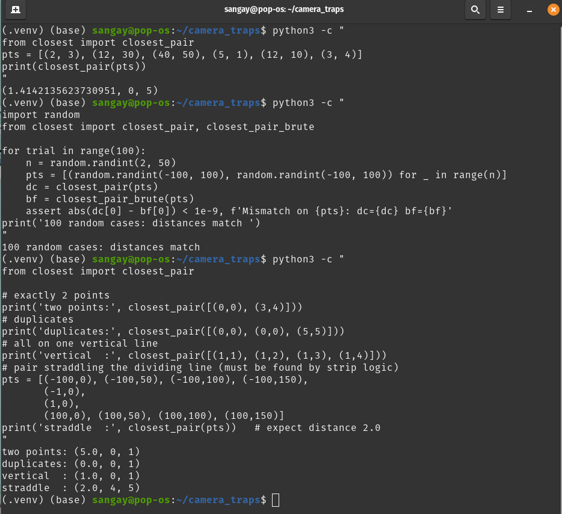
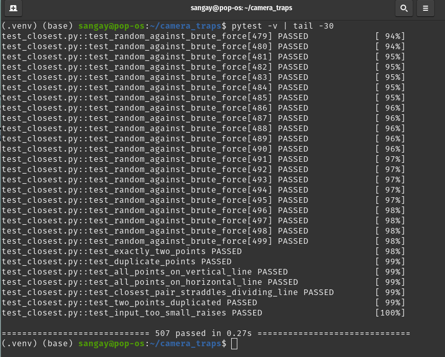
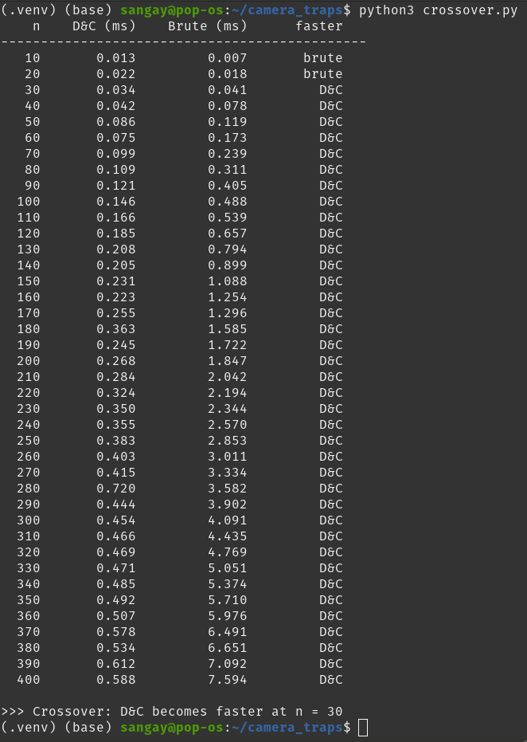

# Assignment 2: Closest Camera Traps

**Module:** CSF302 | **Topic:** Divide and Conquer, Recurrences and Asymptotic Analysis

**Files submitted:** `closest.py`, `test_closest.py`.

---

## 1. Introduction

Camera traps in Jigme Dorji National Park are positioned on a map grid. When two traps sit very close together, they record the same animals and waste batteries, so the field team wants to find the closest pair and relocate one of them. With tens of thousands of traps, the obvious approach of checking every pair takes Θ(n²) time, which quickly becomes impractical.

This report describes my divide-and-conquer solution to the closest-pair-of-points problem. The input is a list of n ≥ 2 points `(x, y)`, and the output is a tuple `(d, i, j)` containing the smallest distance `d` and the indices `i < j` of the two points. I implemented and tested the algorithm, analysed its running time with a recurrence, and compared it empirically against the brute-force baseline.

**Environment:** Python 3.12.7 inside a virtual environment (`.venv`) on Pop!_OS.

---

## 2. Part A: Implementation

Both functions are in `closest.py` and return `(d, i, j)`.

### `closest_pair_brute(points)`

- Compares every pair of points and keeps the smallest distance found.
- Runs in **Θ(n²)** time, since it examines n(n − 1)/2 pairs.
- Used as the reference ("ground truth") for testing the faster version.

*Figure 1: `closest_pair_brute` on the sample input from the brief, returning `(1.414…, 0, 5)`, plus three small checks.*

### `closest_pair(points)` (divide and conquer)

The divide-and-conquer version works as follows:

- **Preserves original indices.** Each point is paired with its original index before any sorting, so the correct `i` and `j` can still be reported afterwards.
- **Sorts by x-coordinate** so the points can be split cleanly into a left and right half.
- **Splits at the midpoint** and recursively solves each half, giving δ = min(δ_left, δ_right).
- **Checks the strip.** Only points within distance δ of the dividing line (a strip of width 2δ) can form a closer cross-boundary pair. The strip is **sorted by y-coordinate**, and each point is compared only with the following points whose y-difference is less than δ.
- **Normalises the result** so the returned indices always satisfy `i < j`.

*Figure 2: `closest_pair` on the sample input, a 100-trial random comparison against brute force, and the four edge cases (two points, duplicates, vertical line, straddling pair).*

---

## 3. Part B: Testing

`test_closest.py` contains **507 tests in total**, all of which pass under `pytest`:

- **500 randomised tests:** random inputs with n between 2 and 50, comparing the divide-and-conquer result against `closest_pair_brute`.
- **7 targeted edge-case tests**, including the four required cases:
  - exactly 2 points;
  - duplicate points (answer 0);
  - all points on a vertical line;
  - the closest pair straddling the dividing line.

  The remaining three are a horizontal line, a duplicated two-point input, and a check that inputs with fewer than two points raise an error.

*Figure 3: `pytest -v` output showing 507 tests passed in 0.27 s.*

---

## 4. Part C: Analysis (Timing and Recurrence)

### 4.1 Recurrence

My implementation sorts the strip by y-coordinate at every level of recursion. The cost of each call is therefore the two recursive calls plus a Θ(n log n) combine step:

> **T(n) = 2T(n/2) + Θ(n log n)**, with base case T(1) = Θ(1)

**Solving with the Master Method (generalised form):**

- a = 2, b = 2, f(n) = n log n
- n^(log_b a) = n^(log₂ 2) = n¹ = n
- f(n) / n = log n = log¹ n, so f(n) = Θ(n^(log_b a) · log^k n) with k = 1

This falls under **Case 2** of the generalised Master Method, so:

> **T(n) = Θ(n log^(k+1) n) = Θ(n log² n)**

### 4.2 Timing results

Both functions were timed on random inputs. As the brief allows, brute force was stopped once it exceeded 60 seconds, so it was skipped at n = 64,000. The growth factor is the time at n divided by the time at the previous (halved) n.

**Table 1: Running times for divide and conquer and brute force**

| n | D&C time (s) | D&C growth factor | Brute-force time (s) | Brute-force growth factor |
|---:|---:|---:|---:|---:|
| 1,000 | 0.0019 | n/a | 0.0473 | n/a |
| 2,000 | 0.0045 | 2.40 | 0.1900 | 4.02 |
| 4,000 | 0.0093 | 2.08 | 0.7662 | 4.03 |
| 8,000 | 0.0203 | 2.19 | 3.3370 | 4.36 |
| 16,000 | 0.0442 | 2.18 | 13.6109 | 4.08 |
| 32,000 | 0.1017 | 2.30 | 54.6492 | 4.01 |
| 64,000 | 0.2541 | 2.50 | skipped (>60 s) | n/a |

*Growth factors were calculated from the unrounded values in `timings.csv`.*

*Figure 4: Log-log plot of running time against n. Both curves are close to straight lines. The brute-force line is steeper (slope ≈ 2) than the divide-and-conquer line (slope slightly above 1), and the gap widens as n grows.*

### 4.3 Crossover point

Brute force is faster for very small inputs because it has a much lower constant overhead: it involves no recursion, no list slicing and no sorting. I ran a fine-grained sweep over small values of n to find the smallest n at which divide and conquer becomes faster. The sweep showed that brute force was faster at n = 10 and n = 20, while divide and conquer was faster from **n = 30** onwards.

*Figure 5: Output of `crossover.py`, reporting that divide and conquer becomes faster at n = 30.*

---

## 5. Part D: Critical Reflection

**1. Did your measured growth match your recurrence?**

Yes, the empirical results strongly confirmed the theoretical analysis. My divide-and-conquer (D&C) recurrence was T(n) = 2T(n/2) + Θ(n log n), which the Master Method solves as Θ(n log² n). In the timing table, each doubling of n (from 1,000 up to 32,000) increased the D&C runtime by a factor of roughly 2.1 to 2.4. This is consistent with the ≈2.3x increase predicted for n log² n. By contrast, the brute-force implementation increased by a factor of about 4.0 per doubling, confirming its Θ(n²) complexity. The only minor anomaly was a few random spikes in the D&C timings (e.g., at n=180), likely due to operating system scheduling interrupting the Python process, but the overall trend was consistent with the recurrence.

**2. Why is brute force faster for small n?**

Despite being asymptotically worse, brute force is faster for small n because of constant factors and overhead. My fine-grained sweep showed a crossover at n=30. For n < 30, the D&C algorithm spends more time on recursive function calls, list slicing, and sorting the strip than it saves by avoiding pair comparisons. The brute-force loop, however, is a simple sequence of comparisons with no setup cost. This highlights a key rule of asymptotic analysis: Big-O describes the limit as n approaches infinity, not the actual speed for small inputs. For small camera trap datasets, a simple brute-force check would actually be the most efficient choice.

**3. Which edge case was hardest, and how did testing help?**

The hardest edge case was ensuring the algorithm preserved the original indices, particularly when the closest pair straddled the dividing line. When points are sorted by their x-coordinates to split the grid, their original input order is lost. If the closest pair is found in the strip during the merge step, it is very easy to accidentally return the indices in reverse order (i.e., i > j), violating the output contract. Writing the 500 randomised test cases with an assertion specifically checking that i < j was crucial. It forced me to add a normalisation step at the end of the recursion to guarantee the correct index order, ensuring the code passed all tests.

---

## 6. Conclusion

The divide and conquer algorithm correctly solves the closest-pair problem in Θ(n log² n) time. It passed all 507 tests against the brute-force reference, and the timing experiments matched the recurrence analysis. Beyond the small crossover at n = 30, it vastly outperforms the Θ(n²) brute-force approach: at n = 32,000 it took about 0.1 s compared with roughly 55 s. This makes it highly suitable for the tens of thousands of camera traps in Jigme Dorji National Park.
