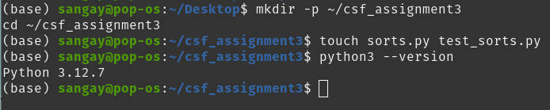
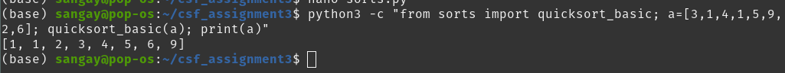
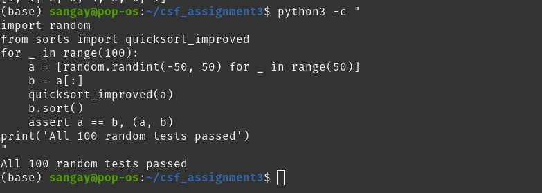
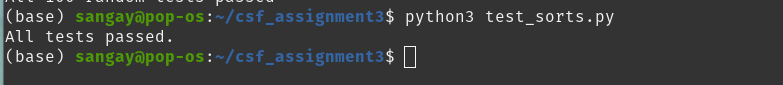
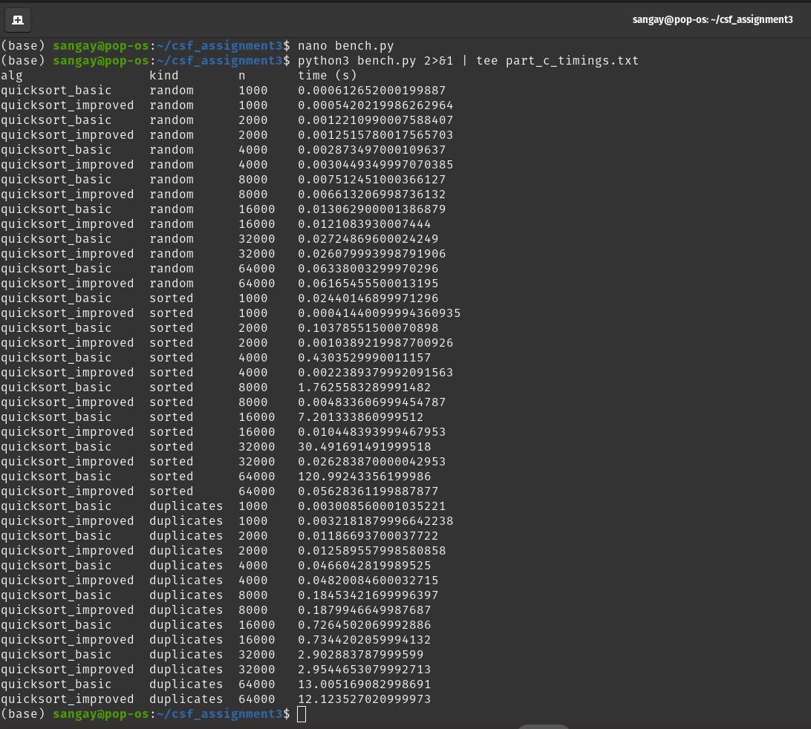
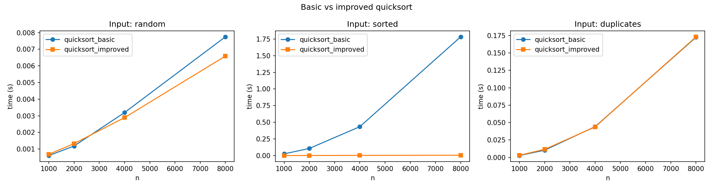
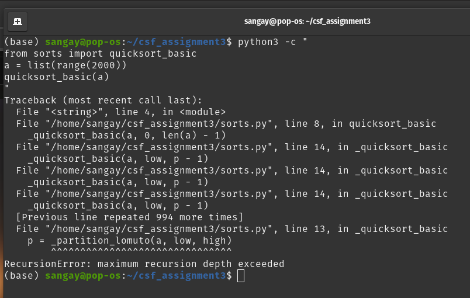
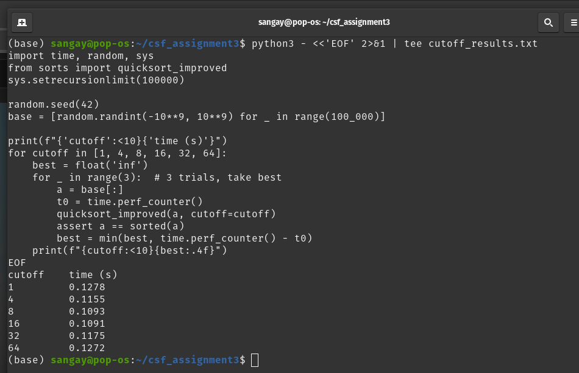
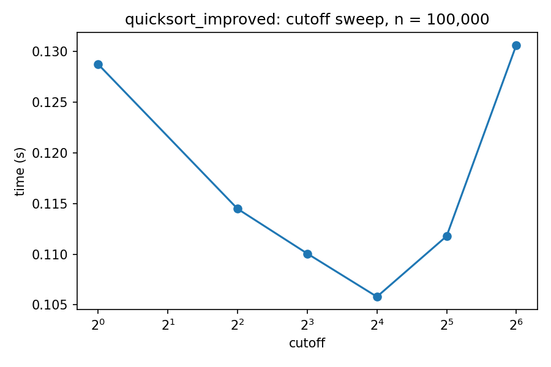
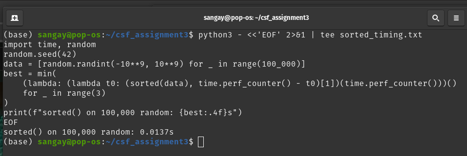

## Assignment 3: Fixing a Slow Quicksort 

### 1. Introduction and Setup

The goal of this assignment was to take a quicksort that looks fine on small random inputs but falls apart on real data, work out why, and fix it. I wrote two versions: a textbook quicksort_basic, and a more careful quicksort_improved. Then I tested both for correctness, timed them on three kinds of input, and compared the best result against Python's built-in sorted().

I did all the work from the Linux terminal. I created the project folder and files with mkdir, cd and touch, and checked my Python version before writing any code. Working this way meant I could run, test and time everything with a few commands, and it made it easy to save outputs into text files (part_c_timings.txt, cutoff_results.txt, sorted_timing.txt) that I could screenshot later.

Figure 0: Project setup in the terminal (mkdir, cd, touch, python3 --version).

### 2. Part A: Implementation

**quicksort_basic**

This is the classic version using Lomuto partitioning with the last element as the pivot. It partitions the list around the pivot, then recursively sorts the left and right parts. It is short and easy to reason about, which is exactly why it makes a good baseline. As I found out later, it is also fragile.

**quicksort_improved**

For the improved version I made three changes, each aimed at a specific weakness in the basic one:

| Improvement | What it does | Why it helps |
|---|---|---|
| Random pivot | Picks a random index and swaps it into the pivot position before partitioning | No fixed input (such as an already sorted list) can reliably trigger bad splits |
| Insertion-sort cutoff (16) | Sub-arrays with 16 or fewer elements are sorted by insertion sort | Avoids the overhead of many tiny recursive calls |
| Recurse on the smaller side, loop on the larger | Only the smaller partition is handled recursively; the larger one is handled by a while loop | Keeps the recursion depth at O(log n) even if a split is unlucky |

**Quick checks while developing**

Before writing a full test file I did a quick import test in the terminal to confirm that quicksort_basic returned correctly sorted output.

Figure A1: Import test of quicksort_basic with correct sorted output.

I then ran a small randomized comparison of quicksort_improved against sorted(), and all 100 random tests passed.

Figure A2: Early randomized check of quicksort_improved (100 random tests passed).

### 3. Part B: Testing

I put the proper tests in test_sorts.py. Both functions are checked against Python's sorted(), which I treated as the ground truth. The script covers two things.

Random tests. 500 randomly generated lists of varying lengths and values, each compared against sorted().

Edge cases. These are the inputs where sorting code usually breaks:

| Edge case | Why it matters |
|---|---|
| Empty list | Base case must not crash |
| Single element | Nothing to partition |
| All elements equal | Partitioning can behave badly with ties |
| Already sorted | The classic worst case for a last-element pivot |
| Reverse sorted | Another structured input that stresses pivot choice |
| Negative numbers | Makes sure nothing relies on values being positive |

Both functions passed everything.

Figure B1: test_sorts.py output showing that all tests passed.

### 4. Part C: Timing and Analysis

**Method**

bench.py times both functions on three input types: random, already sorted, and duplicates (lots of repeated values). Sizes ran from n = 1,000 up to n = 64,000, and the results were written to part_c_timings.txt. I then used plot_results.py to turn the data into graphs. Every time is in seconds.

Figure C1: Timing output from part_c_timings.txt (the full data for every n is in this screenshot).

**Timing table (representative sizes)**

| Input type | n | quicksort_basic (s) | quicksort_improved (s) |
|---|---|---|---|
| Random | 1,000 | 0.00061 | 0.00054 |
| Random | 64,000 | 0.06338 | 0.06165 |
| Sorted | 1,000 | 0.02440 | 0.00041 |
| Sorted | 64,000 | 120.99243 | 0.05628 |
| Duplicates | 1,000 | 0.00300 | 0.00321 |
| Duplicates | 64,000 | 13.00516 | 12.12352 |

Table 1: Basic vs improved timings at the smallest and largest sizes tested. Intermediate sizes are in the Figure C1 screenshot.

**Graph**

Figure 1: Running time of quicksort_basic and quicksort_improved across input sizes and input types.

**What the results show**

Random data: The two versions are almost identical (0.06338 s vs 0.06165 s at n = 64,000). That makes sense. On random data a last-element pivot is already effectively random, so there is nothing for the improvements to fix. The small gain comes from the insertion-sort cutoff.

Sorted data: This is where everything falls apart. At n = 64,000 the basic version took 120.99 s while the improved one took 0.05628 s, a speedup of roughly 2,000×. I also ran quicksort_basic on a sorted list of size 2000 and it hit a RecursionError.

Figure C2: quicksort_basic raising a RecursionError on a sorted input of size 2000.

Duplicates: Both versions were very slow (13.0 s and 12.1 s at n = 64,000). I come back to this below, because it shows that my improvements did not fix everything.

**Why it is slow: the recurrence**

On an already sorted list, the last element is the largest. Lomuto partitioning then puts all n − 1 remaining elements on one side and nothing on the other. So each call only shrinks the problem by one element, giving the recurrence:

T(n) = T(n-1) + Θ(n)

Unrolling it gives n + (n−1) + (n−2) + ... + 1, which is Θ(n²). Recursion depth is also n, which is exactly why Python's recursion limit was hit.

My data fits this. Going from n = 1,000 to n = 64,000 multiplies n by 64, so a quadratic algorithm should slow down by about 64² = 4,096×. The basic version went from 0.0244 s to 120.99 s, which is about 4,960×. That is the same order of magnitude, with the extra slowdown plausibly coming from deep recursion costs, so I am fairly confident this is the quadratic behaviour in action.

The improved version avoids this by choosing the pivot randomly. A random pivot gives balanced-enough splits in expectation, so the average recurrence is closer to T(n) = 2T(n/2) + Θ(n), which is Θ(n log n). Recursing only on the smaller side also caps the recursion depth at O(log n).

A limitation I noticed: the duplicates results show that random pivots alone do not solve everything. Lomuto partitioning puts all values equal to the pivot on the same side, so inputs with many repeated values can still produce lopsided splits. A three-way partition (less than, equal to, greater than) would handle this properly. I did not implement it for this assignment, but it is the next thing I would try.

**Choosing the cutoff**

I ran a sweep over cutoffs of 1, 4, 8, 16, 32 and 64 on 100,000 random values, writing the results to cutoff_results.txt.

Figure C3: Output of the cutoff sweep.

| Cutoff | Time (s) |
|---|---|
| 1 | 0.1278 |
| 4 | 0.1155 |
| 8 | 0.1093 |
| 16 | 0.1091 (best) |
| 32 | 0.1175 |
| 64 | 0.1272 |

Table 2: Cutoff sweep on n = 100,000 random values.

Figure 2: Running time against insertion-sort cutoff.

The curve is U-shaped. A very small cutoff means lots of tiny recursive calls, while a large cutoff means insertion sort handles chunks big enough that its Θ(n²) cost starts to hurt. Cutoff 16 was the best, with 8 almost tied (0.1091 s vs 0.1093 s), so I kept 16. The gap between the best and worst cutoffs is only about 15%, which tells me the cutoff is a fine-tuning knob, not a big win like the random pivot.

**Comparison with Python's sorted()**

I timed sorted() on the same 100,000 random values and saved the result to sorted_timing.txt.

Figure C4: Output of the sorted() timing.

| Method | Time (s), n = 100,000 random |
|---|---|
| Best quicksort_improved (cutoff 16) | 0.1091 |
| Python sorted() | 0.0137 |

Table 3: Best quicksort vs the built-in sort.

sorted() is about 8× faster than my best version. I discuss why in Part D.

### 5. Part D: Critical Reflection

Why did the basic quicksort fail on sorted data, and which assumption of the average-case analysis did real data break? 

Always picking the last element as the pivot is the worst choice on sorted data. The last element is the maximum, so every partition puts n − 1 elements on one side and none on the other. That gives T(n) = T(n-1) + Θ(n) = Θ(n²), with recursion depth n, which is why Python raised a RecursionError. The average-case analysis assumes pivots land at fairly random positions, so splits are roughly balanced and the depth is about log n. Real data broke that, because real inputs are often already sorted or nearly sorted, so a fixed pivot rule is not random relative to the data. Randomising the pivot fixed this (0.05628 s vs 120.99 s at n = 64,000), although my duplicates results show Lomuto partitioning still struggles when many values are equal.

Insertion sort is Θ(n²). Why does using it for small parts make quicksort faster? Big-O hides constant factors and only matters as n grows. On a slice of 16 elements, insertion sort does very little work and has no partitioning or recursion overhead, so its constant is smaller than quicksort's. Switching also removes the huge number of tiny recursive calls at the bottom of the recursion tree. My cutoff sweep shows the trade-off: cutoff 1 took 0.1278 s, cutoff 16 was best at 0.1091 s, and cutoff 64 climbed back to 0.1272 s, where the quadratic cost started to win.

Why is sorted() still faster, and how much comes from the algorithm versus the language?

 sorted() was about 8× faster (0.0137 s vs 0.1091 s). On random data both are Θ(n log n), so the algorithm class is not the main reason. I think most of the gap is the language: sorted() is Timsort running as compiled C on native integers, whereas my code runs as interpreted bytecode, where every index, comparison and swap is a Python operation. The algorithm helps a little too, since Timsort detects existing runs and is close to linear on sorted input. I did not measure the split directly, so this is an informed estimate. Rewriting my quicksort in C would be a clean test.

### 6. Conclusion

I started this assignment thinking quicksort was just "fast on average", and I finished it understanding that "on average" depends on assumptions the data may not respect. The biggest lesson was how much one design choice, the pivot, can matter: a simple random pivot turned a 120-second sort into a 0.056-second one. The insertion-sort cutoff and the smaller-side recursion were smaller wins, but they were easy to measure and I could see why they worked. I also learned to be honest about what my improvements did not fix, since duplicates are still slow, and about how far a pure-Python algorithm can go compared with a built-in sort written in C.