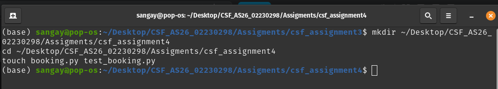
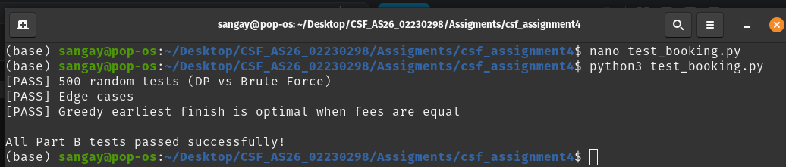
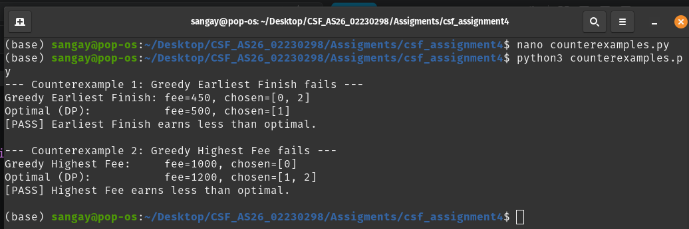
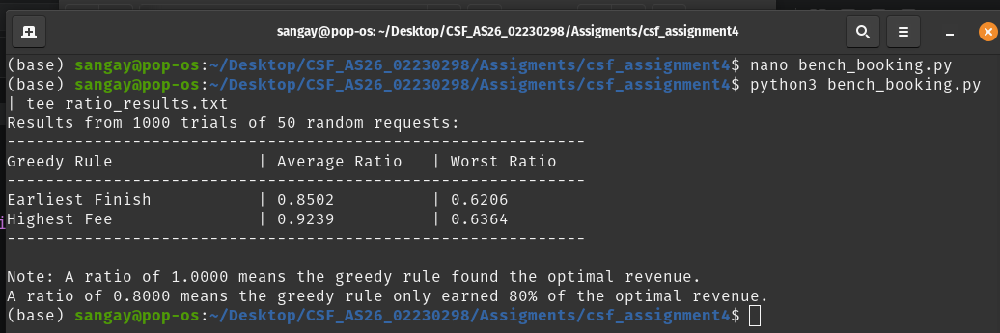

# Assignment 4: Booking the Hall

### 1. Introduction and Setup

The goal of this assignment was to compare greedy algorithms with dynamic programming for the Weighted Interval Scheduling problem. A community hall in Paro receives booking requests, each with a start time, finish time, and fee. The manager wants to maximize the total revenue while ensuring no two events overlap. 

I implemented two greedy strategies (earliest finish and highest fee) and an optimal dynamic programming solution. I tested them against a brute-force checker, analyzed their time complexities, and ran a simulation to see how often the greedy rules fail in practice.

All work was done in the Linux terminal. I created the project folder and files using standard shell commands, which made it easy to run the Python scripts and save my outputs for the report.

*Figure 1: Project setup in the terminal.*

### 2. Part A: Implementation

**Greedy Strategies**
- `greedy_earliest_finish`: Sorts requests by finish time and accepts each one if it does not overlap with the previously accepted request.
- `greedy_highest_fee`: Sorts requests by fee in descending order and accepts each one if it does not overlap with any already accepted requests.

**Dynamic Programming**
- `best_schedule`: Sorts requests by finish time. For each request *j*, it computes *p(j)*, the index of the last request that finishes before *j* starts. It then builds an array `OPT` where `OPT[j] = max(OPT[j-1], fee_j + OPT[p(j)])`. Finally, it traces back through the `OPT` array to reconstruct the chosen requests.

**Brute Force**
- `brute_force`: Tries every possible subset of requests and finds the valid subset with the highest total fee. This is only used for testing on small inputs (n ≤ 15).

### 3. Part B: Testing

I wrote `test_booking.py` to verify the correctness of the implementations. 

*Figure 2: Output of test_booking.py showing all tests passing.*

The test suite covers:
- **500 random tests** comparing `best_schedule` against `brute_force`.
- **Edge cases**: no requests, one request, all overlapping, none overlapping, and back-to-back requests (where one ends exactly when the next begins).
- **Equal fees**: When all fees are equal, `greedy_earliest_finish` is checked against `best_schedule` to confirm it always finds the optimal total.

All tests passed successfully.

### 4. Part C: Analysis

**Counterexamples**
I found small counterexamples (2 to 4 requests) where each greedy rule earns less than the dynamic programming optimum.

*Figure 3: Terminal output showing the greedy rules failing against the optimal DP.*

**Why Greedy Earliest Finish Fails**
Consider: `[(1, 3, 50), (2, 10, 500), (4, 11, 400)]`.

The greedy rule picks the event that ends at 3 (fee 50), which allows it to also pick the event starting at 4 (fee 400), totaling **450**. However, the optimal choice is to skip the first event and take the middle one (fee 500), totaling **500**. The greedy rule makes a locally optimal choice (earliest finish) that blocks a much more lucrative long event.

**Why Greedy Highest Fee Fails**
Consider: `[(1, 10, 1000), (1, 5, 600), (6, 10, 600)]`.

The greedy rule picks the 1000-fee event that spans the entire day, totaling **1000**. However, the optimal choice is to take the two smaller events that fit back-to-back, totaling **1200**. The greedy rule picks the highest single fee, but blocks multiple smaller fees that add up to more.

**Why the DP Recurrence is Correct (Optimal Substructure)**
The recurrence is `OPT(j) = max(OPT(j-1), fee_j + OPT(p(j)))`. 

For any request *j*, there are only two possibilities: either *j* is in the optimal solution or it is not. 
- If *j* is not in the solution, the optimal revenue is simply the best we can do with the first *j-1* requests, which is `OPT(j-1)`.
- If *j* is in the solution, it must be paired with the optimal solution of requests that finish before *j* starts. This is exactly `fee_j + OPT(p(j))`.
Since these are the only two choices, taking the maximum of the two guarantees the globally optimal solution.

**Greedy vs Optimal Revenue Ratios**
I ran 1,000 random inputs of 50 requests each, comparing the greedy revenue to the optimal revenue. The results are shown below:

*Figure 4: Output of the 1,000 trial simulation.*

| Greedy Rule | Average Ratio | Worst Ratio |
| :--- | :--- | :--- |
| Earliest Finish | 0.8502 | 0.6206 |
| Highest Fee | 0.9239 | 0.6364 |

*Table 1: Ratio of greedy revenue to optimal revenue over 1,000 random trials.*

**Time Complexities**
- `greedy_earliest_finish`: **O(n log n)** due to sorting. The scan through the requests takes O(n).
- `greedy_highest_fee`: **O(n²)** in the worst case because for each request, it checks for overlaps against all previously accepted requests.
- `best_schedule`: **O(n log n)** for sorting, plus **O(n²)** to compute the *p(j)* array in the worst case, and **O(n)** to build the `OPT` array. Overall: **O(n²)**. (Note: With binary search, computing *p(j)* can be reduced to O(n log n), making the overall complexity O(n log n)).
- `brute_force`: **O(2ⁿ)** because it checks every subset. This is why it is only used for n ≤ 15.

### 5. Part D: Critical Reflection

**Your greedy rules passed some tests before you found a counterexample. What does this say about using testing to prove correctness?**

It shows that testing can only prove the presence of bugs, not their absence. My greedy rules passed 500 random tests against the brute-force checker without failing. If I had stopped there, I would have wrongly concluded that the greedy rules were optimal. It was only when I manually constructed a specific counterexample that the flaw was revealed. This highlights the importance of formal proof (like the DP recurrence) over relying solely on empirical testing. Random testing is great for finding edge cases, but it cannot guarantee correctness for all possible inputs.

**Should the manager keep the simple rule? Use your revenue ratios from Part C.**

The Highest Fee rule actually performed reasonably well, capturing about 92.4% of the optimal revenue on average. However, its worst-case performance dropped to 63.6%, meaning the manager could lose over a third of potential revenue on a bad day. The Earliest Finish rule was even worse, averaging only 85.0% of optimal. Given that the DP solution is only O(n²) (or O(n log n) with optimization), it is fast enough to run in milliseconds for typical daily bookings. The manager should switch to the DP solution to guarantee maximum revenue.

**Why does greedy work when all fees are equal but fail when fees differ?**

When all fees are equal, maximizing revenue is exactly the same as maximizing the *number* of events. The earliest finish greedy rule is proven to be optimal for the unweighted activity selection problem because picking the event that ends earliest always leaves the most room for future events. However, when fees differ, a shorter event might be worth very little, while a longer event could be worth much more. The greedy rule ignores the weights (fees) entirely, so it can easily pick a low-value event that blocks a high-value one.

### 6. Conclusion

This assignment clearly demonstrated the limits of greedy algorithms. While they are simple to implement and fast, they do not always find the optimal solution when weights are involved. The dynamic programming approach, while slightly more complex, guarantees the best possible revenue. The testing phase also taught me a valuable lesson: passing 500 random tests does not prove an algorithm is correct, and a single carefully constructed counterexample can overturn an assumption.