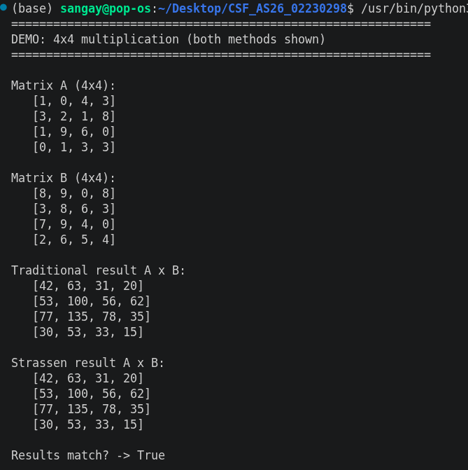
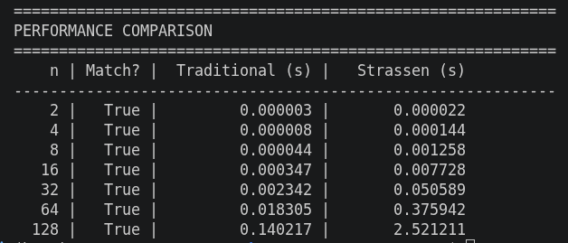
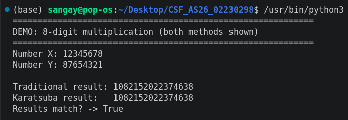
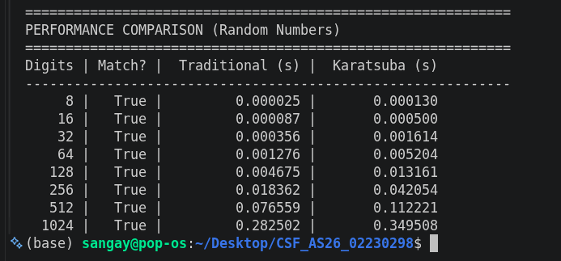
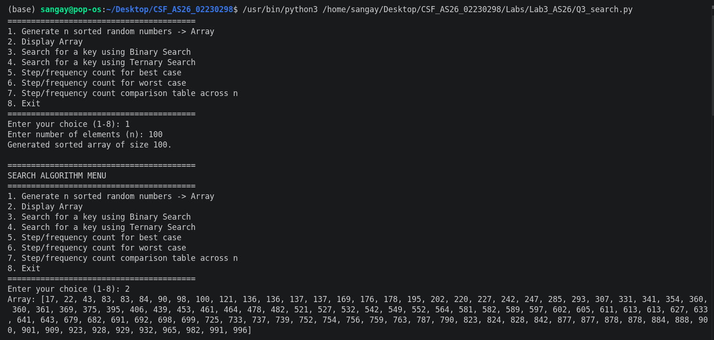
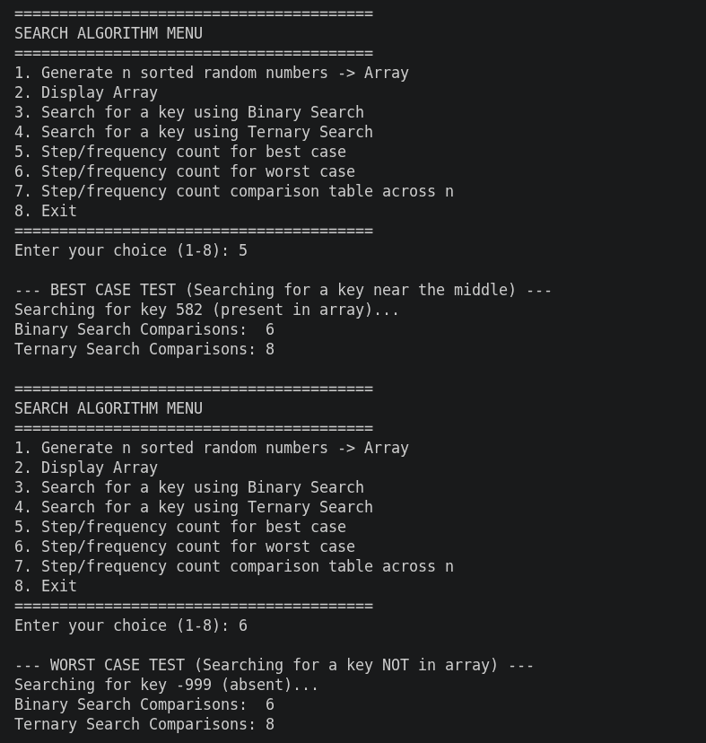
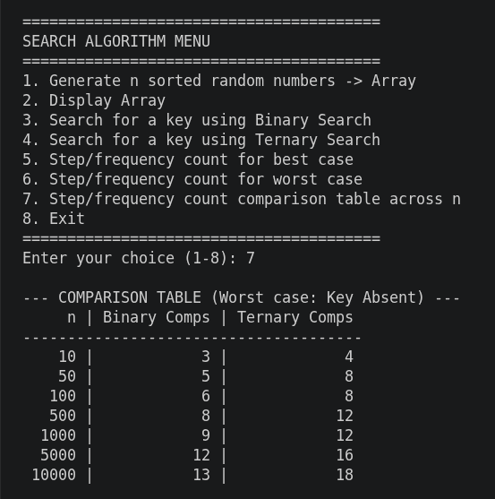

# Lab 3: Algorithm Analysis and Comparison

---

## Q1: Matrix Multiplication — Strassen's vs Traditional

### Objective
Multiply two square matrices (n × n) using the Traditional method and Strassen's Algorithm. Compare their performance and verify that the resultant matrices match.

### Output Verification

> 

### Analysis
Both algorithms correctly produced identical matrices for all test cases (`Match? = True`). However, for smaller matrices (n ≤ 32), the Traditional algorithm was faster. This is due to Strassen's recursion overhead and the heavy cost of Python's list slicing and matrix additions. While Strassen has a theoretically better time complexity (O(n^2.807) vs O(n³)), its overhead makes it inefficient for small inputs in standard Python.

---

## Q2: Karatsuba's Algorithm for Large Integer Multiplication

### Objective
Multiply two large integers using the Traditional method and Karatsuba's Algorithm. Represent integers as strings to support sizes up to 1024 digits and compare performance.

### Output Verification

> 

### Analysis
Karatsuba's algorithm successfully matched the traditional algorithm for all sizes up to 1024 digits. Similar to Q1, the traditional method was faster in our tests. Because we implemented string-based arithmetic in Python to simulate huge numbers, the overhead of string addition, subtraction, and zero-padding severely impacted Karatsuba's performance. Karatsuba reduces the number of multiplications from 4 to 3 per recursive step (O(n^1.585)), but the overhead of string manipulations overshadows this theoretical advantage at these input sizes.

---

## Q3: Binary Search vs Ternary Search (Menu-Driven Program)

### Objective
Write a menu-driven program to search for a key in a sorted array using Binary Search and Ternary Search. Analyze the step/frequency counts (number of comparisons) for best and worst cases.

### Output Verification

>

> 

### Analysis
- **Recurrence Relations:** Binary Search follows `T(n) = T(n/2) + O(1)` making 1 comparison per step. Ternary Search follows `T(n) = T(n/3) + O(1)` but requires **2 comparisons per step** (to check mid1 and mid2).
- **Result:** The step-count tables clearly show that **Binary Search performs fewer comparisons** than Ternary Search for the same `n` (e.g., at n=10000, Binary takes 13 comparisons vs Ternary's 18).
- **Conclusion:** Although Ternary Search divides the array into smaller chunks faster, the requirement of two comparisons at every level to do so makes it less efficient than Binary Search in terms of total comparisons. Therefore, Binary Search is strictly more optimal for 1D arrays.

---

## Final Conclusion
In this lab, I observed that while Divide & Conquer algorithms (Strassen, Karatsuba) have superior theoretical time complexities compared to traditional methods, their practical performance can be worse due to the constant overhead of recursion, memory allocation, and (in Python) string manipulation. Additionally, we proved that Binary Search is mathematically superior to Ternary Search for 1D arrays due to the fewer comparisons required per step.