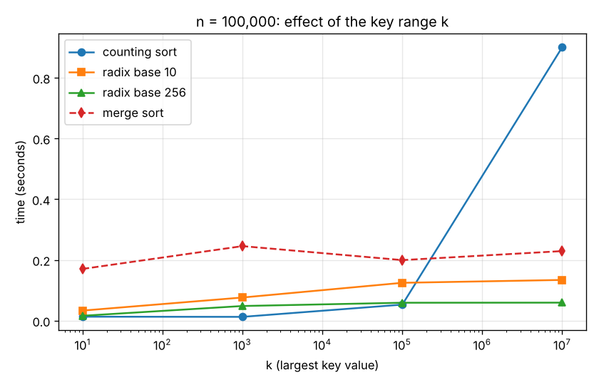
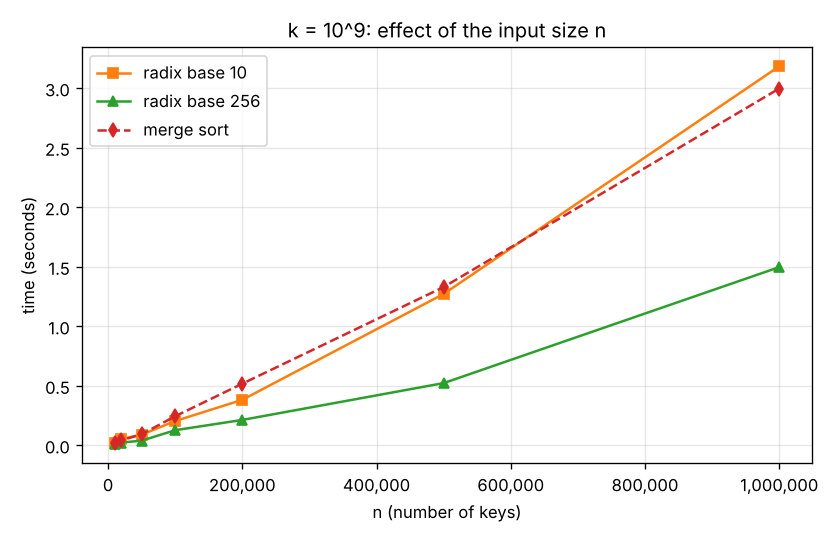

# CSF302 Lab 5: Sorting Algorithms

## Files

| File | Contents |
|---|---|
| `q1_quicksort.py` | Lomuto, Hoare, randomised and three-way quicksort with comparison counts and timing |
| `q2_linear_sorts.py` | Counting sort, LSD radix sort (base 10 and 256), merge sort, plots, stability check |
| `q3_inversions.py` | Brute-force and merge-sort inversion counting, timing, Kendall tau for movie rankings |
| `plots/vary_k.png`, `plots/vary_n.png` | Plots produced by `q2_linear_sorts.py` |

Run with `python q1_quicksort.py`, `python q2_linear_sorts.py` and `python q3_inversions.py`. Q2 needs `matplotlib` for the plots. To try only the movie ranking part of Q3, run `python q3_inversions.py kendall`. All times below were measured with Python 3.13 on Linux, so they will differ on another machine.

---

## Q1: Quicksort Variants

### Implementation

| Variant | Pivot | Partition |
|---|---|---|
| Lomuto | last element `A[hi]` | one scan; elements `<= pivot` go left, pivot is placed in its final position |
| Hoare | middle element, swapped into `A[lo]` | two pointers moving inwards with strict `<` and `>` scans; returns a split point `j` |
| Randomised | random element, swapped into `A[hi]` | Lomuto |
| Three-way | random element | Dutch national flag: `< pivot`, `== pivot`, `> pivot` |

Each sort works in place and returns the number of key comparisons. Every version recurses on the smaller part and uses a `while` loop for the larger part. This keeps the recursion depth at most log2(n), so even Lomuto on a sorted array of 16,000 elements does not hit Python's recursion limit of 1000. Without this trick the depth would be n, and the program would crash with a `RecursionError` for n = 1,000 or more.

Every result was checked against Python's `sorted()`.

Input types: random integers in 0..10n, sorted `0..n-1`, reverse sorted, and many duplicates (random values from 0 to 9).

### Results: number of comparisons

Random input:

| n | Lomuto | Hoare | Randomised | Three-way |
|---|---|---|---|---|
| 1,000 | 12,091 | 14,442 | 10,673 | 17,949 |
| 2,000 | 24,150 | 31,851 | 24,522 | 39,896 |
| 4,000 | 52,934 | 73,816 | 53,811 | 86,847 |
| 8,000 | 128,912 | 156,761 | 117,932 | 181,004 |
| 16,000 | 263,924 | 317,607 | 253,667 | 422,693 |

Already sorted input:

| n | Lomuto | Hoare | Randomised | Three-way |
|---|---|---|---|---|
| 1,000 | 499,500 | 11,804 | 12,425 | 16,786 |
| 2,000 | 1,999,000 | 25,608 | 24,636 | 41,461 |
| 4,000 | 7,998,000 | 55,220 | 56,714 | 90,422 |
| 8,000 | 31,996,000 | 118,440 | 116,954 | 180,684 |
| 16,000 | 127,992,000 | 252,884 | 263,599 | 435,460 |

Reverse sorted input:

| n | Lomuto | Hoare | Randomised | Three-way |
|---|---|---|---|---|
| 1,000 | 499,500 | 11,803 | 10,426 | 17,780 |
| 2,000 | 1,999,000 | 25,611 | 24,743 | 39,880 |
| 4,000 | 7,998,000 | 55,219 | 57,195 | 82,970 |
| 8,000 | 31,996,000 | 118,443 | 118,522 | 190,461 |
| 16,000 | 127,992,000 | 252,883 | 278,835 | 388,078 |

Many duplicates (values 0 to 9):

| n | Lomuto | Hoare | Randomised | Three-way |
|---|---|---|---|---|
| 1,000 | 53,445 | 13,254 | 53,133 | 5,280 |
| 2,000 | 205,870 | 26,444 | 206,395 | 10,444 |
| 4,000 | 814,307 | 57,909 | 813,088 | 24,300 |
| 8,000 | 3,229,132 | 126,473 | 3,236,802 | 50,839 |
| 16,000 | 12,853,768 | 262,014 | 12,863,883 | 99,304 |

### Results: execution time (seconds)

Random input:

| n | Lomuto | Hoare | Randomised | Three-way |
|---|---|---|---|---|
| 1,000 | 0.0014 | 0.0010 | 0.0010 | 0.0015 |
| 2,000 | 0.0017 | 0.0023 | 0.0029 | 0.0036 |
| 4,000 | 0.0036 | 0.0048 | 0.0044 | 0.0074 |
| 8,000 | 0.0084 | 0.0100 | 0.0097 | 0.0155 |
| 16,000 | 0.0181 | 0.0227 | 0.0211 | 0.0348 |

Already sorted input:

| n | Lomuto | Hoare | Randomised | Three-way |
|---|---|---|---|---|
| 1,000 | 0.0268 | 0.0007 | 0.0009 | 0.0014 |
| 2,000 | 0.1134 | 0.0016 | 0.0020 | 0.0032 |
| 4,000 | 0.4996 | 0.0033 | 0.0044 | 0.0073 |
| 8,000 | 1.9296 | 0.0103 | 0.0130 | 0.0206 |
| 16,000 | 8.4380 | 0.0222 | 0.0247 | 0.0484 |

Reverse sorted input:

| n | Lomuto | Hoare | Randomised | Three-way |
|---|---|---|---|---|
| 1,000 | 0.0314 | 0.0012 | 0.0015 | 0.0020 |
| 2,000 | 0.1063 | 0.0016 | 0.0024 | 0.0033 |
| 4,000 | 0.3329 | 0.0034 | 0.0043 | 0.0069 |
| 8,000 | 1.5646 | 0.0104 | 0.0133 | 0.0212 |
| 16,000 | 5.4008 | 0.0147 | 0.0195 | 0.0355 |

Many duplicates:

| n | Lomuto | Hoare | Randomised | Three-way |
|---|---|---|---|---|
| 1,000 | 0.0040 | 0.0010 | 0.0044 | 0.0004 |
| 2,000 | 0.0146 | 0.0019 | 0.0132 | 0.0006 |
| 4,000 | 0.0494 | 0.0042 | 0.0498 | 0.0013 |
| 8,000 | 0.1943 | 0.0085 | 0.1935 | 0.0029 |
| 16,000 | 0.7855 | 0.0183 | 0.8847 | 0.0055 |

### Growth of comparisons when n doubles (8,000 to 16,000)

| Input | Lomuto | Hoare | Randomised | Three-way |
|---|---|---|---|---|
| random | 2.05 | 2.03 | 2.15 | 2.34 |
| sorted | 4.00 | 2.14 | 2.25 | 2.41 |
| reverse | 4.00 | 2.14 | 2.35 | 2.04 |
| duplicates | 3.98 | 2.07 | 3.97 | 1.95 |

For an n log n algorithm, doubling n should multiply the work by a bit more than 2 (about 2.1 here). For a Θ(n^2) algorithm it should multiply the work by 4. The cells close to 4.0 show exactly where the algorithm has degraded.

### Which variant degrades to Θ(n^2), and why

Lomuto on sorted and reverse sorted input. With the last element as pivot, a sorted array always gives the largest element as pivot, so the partition puts n - 1 elements on one side and nothing on the other. A reverse sorted array always gives the smallest element, which is the same problem in the other direction. Every level only removes one element, so the total is (n - 1) + (n - 2) + ... + 1 = n(n - 1)/2 comparisons. The measured value for n = 16,000 is 127,992,000, which is exactly 16000 × 15999 / 2.

Lomuto and randomised quicksort on many duplicates. Both use the Lomuto partition, which sends every element `<= pivot` to the left. With only 10 different values, the subarrays soon contain only one repeated value. In such a subarray every element equals the pivot, so the split is again n - 1 and 0, and each pass removes just one element. Each of the 10 groups has about n/10 elements and costs about (n/10)^2 / 2 comparisons, giving about n^2/20 in total. For n = 16,000 that is 12.8 million, which matches the measured 12.85 million. A random pivot does not help here, because the problem is not a bad pivot choice but the way equal keys are handled.

Hoare did not degrade on any of the four inputs. Using the middle element as pivot means sorted and reverse sorted arrays are split exactly in half. On duplicates, the strict `<` and `>` scans stop at elements equal to the pivot, so equal keys are swapped across and the two pointers meet near the middle, which keeps the splits balanced. Hoare can still reach Θ(n^2) on specially built inputs, but none of these common cases cause it.

Randomised quicksort is fine on sorted and reverse input. The pivot is chosen at random, so the order of the input no longer matters, and the expected number of comparisons is about 2n ln n for any input with distinct keys.

Three-way quicksort did not degrade on any input. It is the clear winner on duplicates, because all elements equal to the pivot are placed in the middle block and never looked at again. With only 10 distinct values, after at most a few levels every block is finished, so the work is close to linear (ratio 1.95). On random input it makes the most comparisons, because an element that is not smaller than the pivot needs a second comparison, so it is about 1.5 times slower than Hoare there.

In terms of real time, Lomuto on a sorted array of 16,000 elements took 8.4 seconds, while Hoare took 0.022 seconds on the same input, which is almost 400 times faster.

---

## Q2: Counting Sort and Radix Sort

### Implementation

Counting sort counts how many times each key 0..k appears, turns the counts into prefix sums, and then places the items into the output array going from right to left. Going backwards is what makes it stable: the last item with a given key is placed in the last slot for that key. The function takes an optional `key` argument so it can sort records like `(key, index)` pairs and single digits of numbers. It runs in Θ(n + k) time and uses Θ(n + k) extra space.

LSD radix sort runs counting sort on each digit, starting from the least significant digit. The digit of x for the current place is `(x // place) % base`. Because counting sort is stable, the order from earlier digits is kept when later digits are equal, so after the last digit the whole array is sorted. With d digits it takes Θ(d(n + base)) time. For keys up to 10^9 this means 10 passes in base 10 but only 4 passes in base 256, since 256^4 is about 4.3 × 10^9.

Merge sort is the standard top-down version (split, sort both halves, merge), which takes Θ(n log n) time in every case.

All outputs were checked against `sorted()`.

### Experiment 1: n = 100,000, k varies

| k | counting sort (s) | radix base 10 (s) | radix base 256 (s) | merge sort (s) |
|---|---|---|---|---|
| 10 | 0.0131 | 0.0332 | 0.0161 | 0.1704 |
| 1,000 | 0.0125 | 0.0763 | 0.0483 | 0.2455 |
| 100,000 | 0.0528 | 0.1247 | 0.0590 | 0.1994 |
| 10,000,000 | 0.9004 | 0.1341 | 0.0593 | 0.2291 |



### Experiment 2: k = 10^9, n varies

| n | radix base 10 (s) | radix base 256 (s) | merge sort (s) |
|---|---|---|---|
| 10,000 | 0.0206 | 0.0072 | 0.0160 |
| 20,000 | 0.0539 | 0.0228 | 0.0418 |
| 50,000 | 0.0890 | 0.0389 | 0.0926 |
| 100,000 | 0.2036 | 0.1267 | 0.2440 |
| 200,000 | 0.3819 | 0.2130 | 0.5174 |
| 500,000 | 1.2713 | 0.5223 | 1.3293 |
| 1,000,000 | 3.1836 | 1.4964 | 2.9969 |

Counting sort was left out of this experiment. With k = 10^9 it would need a count array of a billion entries, which is about 8 GB in Python, just to sort a few thousand numbers.



### When do the linear-time sorts win and lose?

Counting sort wins clearly when the key range is small compared with n. For k = 10 and k = 1,000 it was more than 10 times faster than merge sort. At k = 10^5 (the same size as n) it was still the fastest. But at k = 10^7, which is 100 times larger than n, it became the slowest of all (0.90 s), because most of the time is spent creating and scanning a count array with 10 million entries, most of them zero. The Θ(n + k) bound only counts as "linear" when k = O(n).

Radix sort fixes this by sorting one digit at a time, so the count array only has `base` entries. Its cost depends on the number of digits instead of the size of k. Going from k = 10 to k = 10^7 only increased the base 256 time from 0.016 s to 0.059 s.

The base matters a lot. With k = 10^9, base 10 needs 10 passes and was roughly as slow as merge sort (3.18 s against 3.00 s at n = 10^6). Base 256 needs only 4 passes and was about twice as fast as merge sort at every size. Each extra pass costs a full loop over the data, and in Python this loop is expensive, so the constant factor decides the winner. Merge sort does about log2(n) ≈ 20 levels of work for n = 10^6, which is comparable to 10 counting-sort passes but much more than 4.

Both radix versions and merge sort grow almost in a straight line with n in the second plot. The log n factor of merge sort only goes from about 13 to 20 across this range, so it is hard to see on the plot. The linear sorts would pull further ahead for much larger n, but the main thing that decides the result is the number of digits and the size of the base.

The linear-time sorts lose (or cannot be used) when:

- k is much larger than n (counting sort),
- the keys have many digits for the chosen base, so the number of passes approaches log n (radix base 10 for large keys),
- the keys are not small non-negative integers, for example floats, strings of different lengths, or objects compared by a custom rule,
- memory is limited, since both need extra arrays of size n + k or n + base.

For comparison, Python's built-in `sorted()` (Timsort written in C) is faster than all of these Python versions, but that comes from the language, not the algorithm.

### Stability check

Fifteen random keys from 0 to 4 were paired with their original positions and sorted by key only:

```
before: [(2, 0), (2, 1), (3, 2), (4, 3), (0, 4), (3, 5), (2, 6), (2, 7), (4, 8), (1, 9), (4, 10), (4, 11), (1, 12), (4, 13), (4, 14)]
after:  [(0, 4), (1, 9), (1, 12), (2, 0), (2, 1), (2, 6), (2, 7), (3, 2), (3, 5), (4, 3), (4, 8), (4, 10), (4, 11), (4, 13), (4, 14)]
```

Within every group of equal keys the original indices are still increasing, for example the key 2 items keep the order 0, 1, 6, 7. The same check on 100,000 pairs with keys 0..50 also passed (the result equals Python's stable `sorted()` on the pairs). This stability is the reason radix sort works.

---

## Q3: Counting Inversions

### Implementation

The brute-force version checks every pair i < j and counts the ones with a[i] > a[j]. This is n(n - 1)/2 checks, so Θ(n^2).

The merge-sort version sorts both halves recursively and counts inversions while merging. When an element from the right half is placed before the remaining elements of the left half, it forms an inversion with every one of those remaining elements, so `len(left) - i` is added in one step. The total is the left count plus the right count plus these split inversions, and the running time is Θ(n log n), the same as merge sort.

### Verification

Fixed cases: `[3, 2, 1]` has 3 inversions, `[2, 4, 1, 3, 5]` has 3, `[5, 4, 3, 2, 1, 0]` has 15, and `[1, 1, 1]` has 0 (equal elements do not count). Both methods gave the same answers.

On 300 random arrays with sizes from 0 to 2,000 (some with values in 0..5 so there are many repeats), the two methods disagreed 0 times.

### Timing

| n | inversions | brute force (s) | merge sort (s) |
|---|---|---|---|
| 1,000 | 246,780 | 0.017 | 0.001 |
| 2,000 | 1,009,600 | 0.070 | 0.003 |
| 5,000 | 6,185,393 | 0.430 | 0.010 |
| 10,000 | 25,117,667 | 1.674 | 0.018 |
| 20,000 | 99,788,606 | 7.024 | 0.036 |
| 50,000 | 622,782,968 | 45.553 | 0.104 |
| 100,000 | 2,498,666,557 | stopped after 60 s | 0.244 |
| 200,000 | 9,990,107,762 | skipped | 0.484 |
| 500,000 | 62,394,226,249 | skipped | 1.451 |
| 1,000,000 | 249,869,898,390 | skipped | 3.401 |

The brute force checks the time after every outer loop and gives up once 60 seconds have passed. It did so at n = 100,000, and after that it was not run again because the larger sizes would only take longer.

Doubling n from 10,000 to 20,000 made the brute force 4.2 times slower, which is the expected Θ(n^2) growth. At this rate n = 100,000 would need about 3 minutes and n = 1,000,000 about 5 hours. The merge-sort version roughly doubles each time n doubles and handled one million elements in 3.4 seconds.

The inversion counts are always close to n^2/4. That makes sense, because in a random array each of the n(n - 1)/2 pairs is out of order with probability 1/2.

### Kendall tau distance between two movie rankings

The Kendall tau distance between two rankings is the number of pairs of items that the two people order differently. To compute it, each movie in User 1's list is replaced by its position in User 2's list. A pair that the two users disagree on then appears as an inversion in this new sequence, so the merge-sort inversion counter gives the distance directly in Θ(n log n) time.

The program shows 10 numbered movies, asks each user to type the movie numbers from favourite to least favourite, and re-asks if the input is not a permutation of 1 to 10.

Sample run (the second line was an invalid entry to test the validation):

```
User 1 typed: 1 2 3 4 5 6 7 8 9 10
User 2 typed: 1 2 3                      -> "Each of the numbers 1 to 10 must appear exactly once."
User 2 typed: 2 1 4 3 5 6 9 7 8 10

User 1: Inception > Parasite > Spirited Away > The Dark Knight > Interstellar > Coco > Whiplash > The Matrix > Up > Gladiator
User 2: Parasite > Inception > The Dark Knight > Spirited Away > Interstellar > Coco > Up > Whiplash > The Matrix > Gladiator

Kendall tau distance (pairs ordered differently): 4 out of 45
Normalised distance: 0.089
Similarity (1 - normalised distance): 0.911
Kendall tau coefficient (from -1 to 1): 0.822
The two users have very similar taste.
```

This is easy to check by hand. The users swap Inception and Parasite (1 pair), swap Spirited Away and The Dark Knight (1 pair), and User 2 moves Up ahead of both Whiplash and The Matrix (2 pairs), giving 4 disagreements out of the 10 × 9 / 2 = 45 possible pairs. Two identical rankings would give distance 0, and two completely reversed rankings would give 45.

---

## Conclusion

The choice of pivot and the way equal keys are handled decide whether quicksort stays at n log n or falls to n^2. Lomuto with a fixed pivot fails on sorted input, and any Lomuto-based version fails on many duplicates, while Hoare and three-way partitioning stay fast. Counting and radix sort can beat merge sort, but only when the keys are small integers and the number of passes is small. Finally, the merge-sort trick for counting inversions turns a problem that took over a minute for 100,000 elements into one that takes a quarter of a second, and it gives a practical way to compare rankings.
