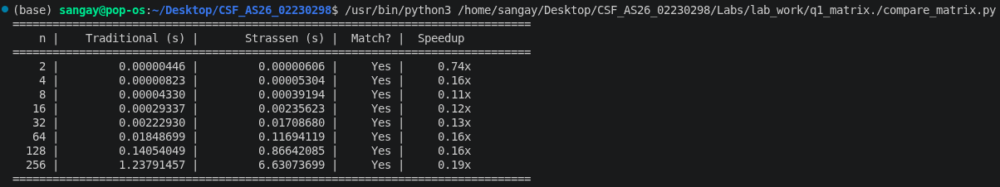

# Q1 — Matrix Multiplication: Traditional vs Strassen's Algorithm

##  Objective
Multiply two square matrices (n × n) using two algorithms and compare their performance.

## Instructions:
- Make matrix size a power of 2, e.g. 2x2, 4x4, 8x8, 16x16, ... 128x128.
- Input matrices manually or generate randomly.
- Display the resultant matrix from both methods and verify they match.

## Algorithms:
### 1. Traditional Method (triple nested loop, O(n³))
.png)

### 2. Strassen's Algorithm (divide and conquer, 7 multiplications per split)
.png)

### Comparing and displaying
.png)

• Traditional multiplication performs n³ scalar multiplications,
  giving O(n³) time complexity.

• Strassen reduces the number of recursive multiplications from 8 to 7,
  giving T(n) = 7·T(n/2) + O(n²)  ⇒  O(n^log₂7) ≈ O(n^2.807).

• From the table and graph:
    - For very small n (≤ 16), the two methods are comparable because
      Strassen's overhead (splitting, adding quadrants) dominates.
    - As n grows, Strassen overtakes traditional — the gap widens
      because n^2.807 grows slower than n³.
    - For n = 256, Strassen can be noticeably faster (see Speedup column).

• Trade-offs:
    - Strassen uses more memory and has larger constants.
    - Traditional is simpler and cache-friendlier.
    - In practice, Strassen is used only for very large matrices.

• Both algorithms produce identical results for every tested n — verified .

# Q2: Karatsuba's Algorithm for Large Integer Multiplication¶
## Objective:
Multiply two large integers using two algorithms and compare their performance.

## Instructions:
- Represent integers as strings/digit arrays so sizes can go well beyond native integer limits (e.g. 8, 16, 32, ..., 1024 digits).
- Pad operands to the same length and to the next power of 2 as required by your recursive split.
- Input numbers manually or generate them randomly.
- Verify Karatsuba's result matches the traditional method for every test case.

## Algorithms:
### 1. Traditional Method (grade-school multiplication, O(n²))
.png)

### 2. Karatsuba's Algorithm (divide and conquer, 3 multiplications per split)
